# PostgreSQL database design

Logical relational schema, version 0.1. **No SQL migration is executed or delivered as an approved migration in Task 001.** All entities below are proposed, including later phases. Implement only the phase-approved subset, preserving its invariants.

Task 002 clarification: see [architecture corrections](TASK_002_ARCHITECTURE.md). Membership and transaction uniqueness are explicitly tenant-scoped; global and tenant membership sessions are distinct. No DDL has been implemented.

## Conventions and tenant boundary
`T` = mandatory tenant_id UUID; `ID` = UUID; `TS` = timestamptz; `D` = date; `M` = bigint paise; `Q` = numeric(18,3); `R` = numeric(12,6). Monetary intermediate calculations use a decimal library; posted amounts are integer paise. INR currency is explicit on documents and ledgers. Prices use numeric(20,6) INR when needed for inclusive-tax/unit allocation, converted to M at defined boundaries. Text is bounded by validation, enums/checks constrain states. All timestamps use UTC; shop-local business_date and financial_year are explicit.

Unless a different key is listed, **every table in the business catalog has `(tenant_id, id)` as its primary key**, a tenant_id FK to tenants(id), created_at TS and created_by_membership_id (nullable only for documented system jobs). Mutable masters also have updated_at, version integer and archived_at nullable. Posted facts have no soft-delete flag and are immutable. All `→ table` references expand to `(tenant_id, referenced_id) REFERENCES table(tenant_id,id) ON DELETE RESTRICT`; this rule applies to every field ending `_id` in the catalog unless explicitly identified as a global identity reference, document subtype primary key or external opaque reference. Add an index on every referencing composite FK. Tenant-leading secondary indexes are mandatory. `U(...)` means UNIQUE including tenant_id. All fields are NOT NULL except `?` and documented optional fields. Arrays of business IDs are prohibited; join tables model relationships. JSONB is limited to versioned immutable snapshots, rule predicates and audit metadata, not relational links.

System-only tables are global: identity_accounts, identity_credentials, identity_sessions, permission_definitions and migration_history. They contain no shop sales/customer data. Tenant business profiles live in memberships/employees. API roles cannot query identity_accounts directly for tenant business exports. A tenant row is itself the scoped business root; policy is id = current tenant context. Global tax publications are stored as cited source metadata per tenant rule pack, avoiding cross-tenant writable rules.

Each table receives `ENABLE ROW LEVEL SECURITY` and `FORCE ROW LEVEL SECURITY`, including partitions. API role is neither owner, superuser nor BYPASSRLS. USING and WITH CHECK require tenant context. Scoped membership/branch grants are also checked before commands. Branch-restricted tables receive policies checking branch access through a security-reviewed membership scope resolver. Migration role is separate and unavailable to application workers. Every DB request runs in a transaction with SET LOCAL tenant and membership context from server-validated membership; context absent fails closed. Pool reuse never preserves another tenant context. RLS is defence in depth against accidental queries, not protection from arbitrary SQL execution by a compromised trusted backend.

## Organisation and identity catalog
| Table | Columns beyond conventions | Keys, checks and indexes |
|---|---|---|
| identity_accounts (global) | id PK, normalised_email, password_hash?, email_verified_at?, disabled_at?, created_at | U(normalised_email); external auth later in identity_credentials; password hash never exposed |
| identity_credentials (global) | id PK, identity_id → identity_accounts, provider, provider_subject, created_at | UNIQUE(provider,provider_subject); contains no business data |
| permission_definitions (global) | code text PK, description | Application-owned versioned catalogue, e.g. sales.finalise, customer.measurements.read |
| migration_history (global) | version PK, checksum, applied_at, runner_version | Immutable deployment metadata |
| tenants | id UUID PK, name, status, timezone, currency, created_at, archived_at? | CHECK currency='INR' initially; RLS id=current tenant; no tenant_id self-reference |
| memberships | identity_id → global identity_accounts, display_name, status, valid_from, valid_to? | UNIQUE(tenant_id,identity_id); index identity_id,status for membership discovery via constrained auth query |
| shops | code, legal_name, display_name, address fields, state_code, timezone, current_registration_id? → tax_registrations | U(code); current pointer is convenience, effective histories authoritative |
| branches | shop_id → shops, code, name, address, state_code, type(store/warehouse), active | U(shop_id,code); additional U(shop_id,id) supports branch-shop consistency FKs |
| membership_scopes | membership_id → memberships, shop_id → shops, branch_id? → branches, all_shop_branches boolean | U(membership_id,shop_id,branch_id) with NULLS NOT DISTINCT; branch FK also includes shop_id; NULL only if all_shop_branches |
| roles | code, name, platform_protected boolean | U(code); platform support is not a tenant-assignable superuser role |
| membership_roles | membership_id → memberships, role_id → roles | U(membership_id,role_id) |
| role_permissions | role_id → roles, permission_code → global permission_definitions | U(role_id,permission_code) |
| membership_sessions | membership_id → memberships, identity_session_id → global identity_sessions, expires_at, revoked_at?, device_id? → devices | U(identity_session_id,membership_id); index expiry; membership mandatory, global session revocation invalidates tenant context |
| identity_sessions (global) | id PK, identity_id FK, token_hash UNIQUE, expires_at, revoked_at? | No business payload; only membership selection/auth flow |
| devices | branch_id → branches, code, public_key?, revoked_at?, last_seen_at? | U(code); no offline queue implementation yet |
| employees | membership_id? → memberships, branch_id → branches, employee_code, name, employment_status | U(employee_code); U(membership_id) WHERE not null |

## Catalogue, pricing and inventory catalog
| Table | Columns beyond conventions | Keys, checks and indexes |
|---|---|---|
| categories | parent_id? → categories, code, name | U(code); service rejects cycles |
| brands | code, name | U(code) |
| units | code, label, precision, kind(piece/length) | U(code); piece precision=0; length disabled until textile phase |
| products | category_id → categories, brand_id? → brands, unit_id → units, style_code, name, description?, hsn_code, status | U(style_code); trigram index name; HSN is classification text, not a numeric FK |
| product_variants | product_id → products, sku, size_code, colour_code, display_name, active | U(sku), U(product_id,size_code,colour_code); dimension codes non-null, use explicit NA |
| variant_barcodes | variant_id → product_variants, barcode text, format, primary_flag | U(barcode); partial unique primary per variant |
| price_versions | variant_id → product_variants, shop_id → shops, effective_range tstzrange, purchase_price, selling_price, mrp, tax_inclusive boolean, approval_id? → approvals | Nonnegative prices; exclude overlapping variant/shop/range using GiST; MRP override permission/legal check |
| product_tax_assignments | product_id → products, registration_id → tax_registrations, rule_version_id → tax_rule_versions, effective_range | Exclude overlaps per product/registration; freeze rule reference on posting |
| stock_locations | branch_id → branches, code, kind(sellable/quarantine/in_transit) | U(branch_id,code); U(branch_id,id) |
| stock_balances | branch_id → branches, location_id → stock_locations, variant_id → product_variants, quantity Q, stock_value M, reorder_level Q, version | U(location_id,variant_id); same-branch composite location FK; nonnegative qty/value by default; quantity zero implies value zero after approved rounding |
| stock_movements | document_id → business_documents, branch_id → branches, location_id → stock_locations, variant_id → product_variants, delta Q, value_delta M, movement_type, source_line_no, reversal_of_id? → stock_movements, occurred_at | U(document_id,source_line_no,location_id,variant_id,movement_type); delta !=0 except explicit value-only adjustment; index variant/time, location/time; append-only |
| stock_counts | branch_id → branches, document_id → business_documents, status, counted_at, approved_by? → memberships | U(document_id) |
| stock_count_lines | count_id → stock_counts, balance_id → stock_balances, observed_version, expected_qty Q, counted_qty Q, reason | U(count_id,balance_id); nonnegative counted; reconcile version changes before posting |
| stock_transfers | document_id → business_documents, from_branch_id → branches, to_branch_id → branches, status, dispatched_at?, received_at? | U(document_id); branches differ; same legal seller only initially |
| stock_transfer_lines | transfer_id → stock_transfers, variant_id → product_variants, quantity Q, received_qty Q | U(transfer_id,variant_id); 0<=received<=quantity; shortage reason on settlement |

Valuation proposal: perpetual weighted average per branch/variant across relevant sellable locations, with locked balance/value updates. Sale lines store exact allocated COGS. Returns restore original line cost; damaged stock is reclassified. Transfers move original cost through in-transit location. No historical cost silently recalculated after issue; backdated changes after period close require approved adjustment. Owner/CA must approve costing before Phase 2.

## Document, sale and tax catalog
Business document registry provides a real FK for stock, journal, audit and generated-file sources, avoiding unvalidated polymorphic `(type,id)` pointers. Subtype tables use the registry's ID as `(T,id)` PK/FK; `kind` must match by deferred constraint trigger. Registry insertion and subtype insertion occur in the same transaction; deferred trigger rejects missing/duplicate wrong subtype at commit for posted documents. Drafts can use same registry with no legal number.

| Table | Columns beyond conventions | Keys, checks and indexes |
|---|---|---|
| business_documents | shop_id → shops, branch_id → branches, registration_id → tax_registrations, kind, status(draft/posted/reversed), business_date D, currency, client_transaction_id UUID, version, posted_at? | UNIQUE(tenant_id,client_transaction_id); composite branch/shop FK; index branch,date,kind; immutable once posted except controlled reversal-state transition |
| document_series | registration_id → tax_registrations, financial_year text, document_kind, series_code, next_number bigint | U(id,registration_id,financial_year,document_kind) for composite number FK; U(registration_id,financial_year,document_kind,series_code); next>0; legal format validated |
| document_numbers | document_id → business_documents, series_id → document_series, registration_id → tax_registrations, financial_year text, document_kind, sequence bigint, rendered_number, void_reason? | U(document_id), U(series_id,sequence); U(registration_id,financial_year,document_kind,rendered_number) using copied series dimensions plus composite FK to series; never reuse committed number |
| sales_drafts | id → business_documents, customer_id? → customers, salesperson_id? → employees, shift_id → shifts, expires_at?, draft_revision | Draft is not reserved stock; same-branch shift FK |
| sales_draft_items | draft_id → sales_drafts, line_no, variant_id → product_variants, quantity Q, requested_discount, price_version_id → price_versions | U(draft_id,line_no); positive quantity; mutable until finalisation |
| invoices | id → business_documents, customer_id? → customers, salesperson_id? → employees, shift_id → shifts, type(tax_invoice/bill_of_supply/non_gst), subtotal M, discount M, taxable M, tax M, rounding M, total M, cogs M, due_date?, seller_snapshot JSONB, customer_snapshot JSONB, template_version | Same document ID as posted source draft; subtype exclusivity allows retained draft marked consumed; sum checks via deferred posting trigger; credit requires customer |
| invoice_items | invoice_id → invoices, line_no, variant_id → product_variants, quantity Q, unit_price numeric(20,6), gross M, discount M, taxable M, tax M, total M, cogs M, product_snapshot JSONB | U(invoice_id,line_no); positive quantity; product snapshot includes SKU/name/size/colour/HSN/UOM/MRP |
| tax_registrations | legal_entity_name, gstin?, state_code, registration_reference, current_status | Multiple registrations allowed per tenant; U(gstin) where present; unregistered has no GSTIN; registration referenced by shops/series/documents |
| registration_periods | registration_id → tax_registrations, scheme(regular/composition/unregistered), effective_range daterange, evidence_file_id? → files, approved_by → memberships | Exclude overlapping ranges per registration; validate required GSTIN by period; no historical overwrite |
| tax_rule_versions | rule_code, version_no, effective_range daterange, jurisdiction, hsn_match, predicates JSONB, rates JSONB, rounding_policy JSONB, document_policy JSONB, source_id → tax_sources, approval_status | U(rule_code,version_no); no overlapping approved rule scopes; conflicting match rejected; JSON schema validated/versioned; immutable approved versions |
| tax_sources | source_url, title, publication_date?, retrieved_at TS, source_sha256?, reviewed_by?, review_reference? | Metadata, not a claim that law is up to date; reviewer identity/reference recorded |
| invoice_tax_snapshots | invoice_id → invoices, registration_period_id → registration_periods, rule_pack_hash, engine_version, supply_date D, place_of_supply_state, treatment, seller_gstin?, recipient_gstin?, full_snapshot JSONB | U(invoice_id); required before post; snapshot schema version and checksum; preserves resolved inputs |
| invoice_item_taxes | item_id → invoice_items, rule_version_id → tax_rule_versions, component(CGST/SGST/UTGST/IGST/CESS), rate R, base M, amount M, exemption_reason? | U(item_id,component); nonnegative rates/amount; no CGST+IGST mixture per treatment |
| sales_returns | id → business_documents, original_invoice_id → invoices, exchange_id? → exchanges, reason, approved_by → memberships, total M | Original invoice customer and legal seller verified; same tenant/registration initial scope |
| sales_return_items | return_id → sales_returns, original_item_id → invoice_items, quantity Q, disposition, credit_amount M, tax_reversal M, cost_reversal M | U(return_id,original_item_id,disposition); cumulative returned qty bounded with original-item lock |
| tax_notes | id → business_documents, invoice_id → invoices, return_id? → sales_returns, note_kind(credit/debit), legal_basis, taxable_delta M, tax_delta M, total_delta M, eligibility_status, report_period | U(return_id) for return-based credit; direction sign check; independent legal series |
| tax_note_items | note_id → tax_notes, original_item_id → invoice_items, quantity Q, base_delta M, tax_delta M, snapshot JSONB | U(note_id,original_item_id); use original rule history; snapshots explain adjustment |
| exchanges | customer_id → customers, original_invoice_id → invoices, replacement_invoice_id? → invoices, status, net_settlement M | U(replacement_invoice_id) if present; posted return/new sale group atomic, same registration initial scope |
| composition_liabilities | registration_id → tax_registrations, rule_version_id → tax_rule_versions, period_start D, period_end D, eligible_turnover M, excluded_turnover M, liability M, review_status, filed_reference? | U(registration_id,period_start,period_end,rule_version_id); not invoice GST collected from customer |
| gst_report_runs | registration_id → tax_registrations, period, report_kind, as_of TS, rule_pack_hash, file_id → files, status, reviewer? | Index registration,period; immutable export version; not automatic statutory filing |

## Customers, money and purchasing catalog
| Table | Columns beyond conventions | Keys, checks and indexes |
|---|---|---|
| customers | shop_id → shops, code, name, phone?, email?, dob_month?, dob_day?, gstin?, credit_limit M, status | U(shop_id,code); phone index, not universally unique (families share phones); optional DOB, no mandatory birth year |
| customer_shop_links | customer_id → customers, linked_customer_id → customers, consent_reference?, approved_by → memberships | U(customer_id,linked_customer_id); explicit matching, no automatic cross-shop merging |
| customer_consents | customer_id → customers, channel, purpose, action(grant/withdraw), captured_at TS, source, wording_version, evidence_file_id? → files | Append-only; index customer/channel/purpose/time; current state derived; no generic blanket consent |
| payments | id → business_documents, direction(in/out), provider?, provider_event_id?, customer_id? → customers, supplier_id? → suppliers, shift_id? → shifts, method, amount M, reconciliation_status, external_reference?, received_at | amount>0; exactly one party or walk-in cash context; U(provider,provider_event_id) if integrated later, provider nullable |
| payment_allocations | payment_id → payments, target_document_id → business_documents, amount M, allocation_kind, reversal_of_id? → payment_allocations | positive amount; allocation/reversal ledger, target supports same party/shop/currency; locking enforces not overallocated |
| refunds | id → business_documents, return_id? → sales_returns, original_payment_id? → payments, outbound_payment_id → payments, amount M, reason, approved_by → memberships | U(outbound_payment_id); cap cumulative refund/available customer credit under locks |
| ledger_accounts | shop_id → shops, code, type(asset/liability/income/expense/equity), customer_id? → customers, supplier_id? → suppliers | U(shop_id,code); separate receivable, customer advance, payable and cash accounts |
| journals | document_id → business_documents, posting_kind, business_date, reversal_of_id? → journals, period_id → accounting_periods | U(document_id,posting_kind); index date; posted only when debit=credit |
| journal_lines | journal_id → journals, line_no, account_id → ledger_accounts, debit M, credit M, branch_id → branches | U(journal_id,line_no); nonnegative, exactly one positive; deferred sum debit=credit trigger |
| accounting_periods | shop_id → shops, date_range daterange, status(open/closed), closed_by? → memberships | Exclusion overlapping ranges; posting blocked in closed period; reopening audited |
| shifts | branch_id → branches, cashier_id → memberships, opened_at, closed_at?, opening_float M, expected_cash M?, counted_cash M?, variance M?, approved_by? → memberships | Partial U(branch_id,cashier_id) where open; U(branch_id,id); closed immutable |
| cash_movements | document_id → business_documents, shift_id → shifts, direction, amount M, reason, approved_by? → memberships | U(document_id); amount>0; separate paid-in/out from sale receipts |
| suppliers | shop_id → shops, code, name, gstin?, contacts JSONB, payment_terms_days | U(shop_id,code); contacts structured scalar data, no hidden FKs |
| purchase_orders | id → business_documents, supplier_id → suppliers, expected_on?, status, total M | Index supplier/date; approval required above configured limit |
| purchase_order_items | order_id → purchase_orders, line_no, variant_id → product_variants, quantity Q, agreed_unit_cost numeric(20,6) | U(order_id,line_no); quantity>0 |
| goods_receipts | id → business_documents, supplier_id → suppliers, purchase_order_id? → purchase_orders, received_on, status | Index supplier/date; receipt posts stock once |
| goods_receipt_items | receipt_id → goods_receipts, line_no, po_item_id? → purchase_order_items, variant_id → product_variants, quantity Q, provisional_cost M, disposition | U(receipt_id,line_no); positive quantity; received totals under ordered quantity unless approved tolerance |
| purchase_invoices | id → business_documents, supplier_id → suppliers, supplier_invoice_number, supplier_invoice_date, supplier_financial_year text, due_date, taxable M, tax M, total M, attachment_id? → files | U(supplier_id,supplier_invoice_number,supplier_financial_year); field supplier_financial_year text stored; duplicate check review |
| purchase_invoice_items | purchase_invoice_id → purchase_invoices, line_no, variant_id → product_variants, quantity Q, taxable M, tax M, total M, hsn, tax_snapshot JSONB | U(purchase_invoice_id,line_no) |
| purchase_receipt_allocations | purchase_item_id → purchase_invoice_items, receipt_item_id → goods_receipt_items, quantity Q, cost_delta M | U(purchase_item_id,receipt_item_id); locks bound allocated qty; invoicing must not add receipt stock again |
| input_tax_records | purchase_item_id → purchase_invoice_items, component, invoiced M, eligible M, claimed M, reversed M, eligibility_reason, reconciliation_status, rule_version_id → tax_rule_versions, reviewed_by? → memberships, claim_period? | U(purchase_item_id,component); composition/unregistered eligible/claimed=0; regular eligibility not automatic |
| purchase_returns | id → business_documents, supplier_id → suppliers, purchase_invoice_id? → purchase_invoices, reason, total M | References receipt lines for stock; tax/vendor credit review separate |
| purchase_return_items | return_id → purchase_returns, receipt_item_id → goods_receipt_items, purchase_item_id? → purchase_invoice_items, quantity Q, value M, tax_snapshot JSONB | U(return_id,receipt_item_id); cumulative qty bounded, stock locked |
| expenses | id → business_documents, category_code, supplier_id? → suppliers, amount M, tax M, attachment_id? → files, approved_by? → memberships | Index expense_category_id/business_date via document; approved expense only posts |
| expense_categories | code, name | U(code) |
| estimates | id → business_documents, customer_id → customers, valid_until, status, proposed_total M | Phase 4 proposal; no stock/sales recognition; deposits are payments/advances |
| estimate_items | estimate_id → estimates, line_no, variant_id → product_variants, quantity Q, price_snapshot JSONB | U(estimate_id,line_no) |

Payments reduce receivables/payables through allocations; unallocated receipts remain customer advances. Credit sale is an invoice with remaining balance, not a fictional credit payment. Split payments create multiple payment documents and allocations. No editable totalSpent/dues source fields: derive them from facts or reconciled projections.

## Later operations, engagement and SaaS catalog
| Table | Columns beyond conventions | Keys, checks and indexes |
|---|---|---|
| alteration_jobs | document_id → business_documents, invoice_item_id? → invoice_items, customer_id → customers, tailor_id → employees, measurement_version_id? → measurement_versions, promised_at, status, instructions | U(document_id); restricted reads; index tailor/status/promised_at |
| measurement_profiles | customer_id → customers, label, retention_until?, encrypted_metadata | U(customer_id,label); specialised permission |
| measurement_versions | profile_id → measurement_profiles, version_no, encrypted_values, captured_at, captured_by → memberships | U(profile_id,version_no); no public invoice inclusion |
| job_events | job_id → alteration_jobs, event, occurred_at, actor_id → memberships, note | Append-only status history |
| payroll_runs | document_id → business_documents, branch_id → branches, month D, status | U(document_id); U(branch_id,month); later phase only |
| payroll_lines | run_id → payroll_runs, employee_id → employees, base M, bonus M, deductions M, net M, payment_id? → payments | U(run_id,employee_id); net=base+bonus-deductions |
| loyalty_accounts | customer_id → customers, shop_id → shops | U(customer_id,shop_id) |
| loyalty_entries | account_id → loyalty_accounts, document_id → business_documents, entry_kind(earn/redeem/reverse), points bigint signed, expires_at?, reversal_of_id? → loyalty_entries | U(account_id,document_id,entry_kind), entry_kind earn/redeem/reverse; balance derived, locked during redemption |
| segments | shop_id → shops, name, definition_version, predicates JSONB | U(shop_id,name,definition_version); safe allowlisted query builder |
| marketing_campaigns | shop_id → shops, segment_id? → segments, channel, purpose, template_version, scheduled_at?, status, approved_by? → memberships | Index status/scheduled_at; consent gate required |
| campaign_recipients | campaign_id → marketing_campaigns, customer_id → customers, consent_id → customer_consents, status, suppression_reason? | U(campaign_id,customer_id); consent rechecked at send, snapshot alone insufficient |
| message_deliveries | recipient_id? → campaign_recipients, document_id? → business_documents, purpose, channel, provider_reference?, status, attempt_count, dedupe_key | U(dedupe_key); status callbacks authenticated; exact one source required |
| subscriptions | plan_code, starts_at, ends_at?, status, external_reference? | Partial UNIQUE(tenant_id) for active subscription; no payment provider now |
| subscription_entitlements | subscription_id → subscriptions, feature_code, limit_value?, effective_range | U(subscription_id,feature_code,effective_range); nonoverlap |
| files | owner_document_id? → business_documents, storage_key, media_type, size_bytes, sha256, classification, retention_until? | U(storage_key); owner may instead be explicit consent/measurement relation; no arbitrary public URLs |
| document_renders | document_id → business_documents, format, template_version, snapshot_hash, file_id → files, status | U(document_id,format,template_version,snapshot_hash) |
| invoice_share_links | invoice_id → invoices, token_hash, expires_at, revoked_at? | U(token_hash); no raw tokens in logs; field projection fixed |
| approvals | operation, subject_document_id? → business_documents, requested_by → memberships, approved_by? → memberships, reason, status, payload_hash | Creator cannot approve own protected action; hash binds scope |
| audit_logs | actor_id? → memberships, action, document_id? → business_documents, target_type?, target_id?, before_hash?, after_hash?, reason?, occurred_at, request_id, metadata JSONB | Append-only; target_type/id audit context only, never authoritative relationships; indexes actor/time and document/time; redact PII/secrets |
| idempotency_requests | operation, key, request_hash, actor_id → memberships, client_transaction_id, state, response_ref? → business_documents, response_status?, expires_at | U(operation,key); bounded response metadata; durable posting uniqueness beyond expiry |
| outbox_events | document_id? → business_documents, event_type, aggregate_version, payload JSONB, available_at, lease_until?, attempts, delivered_at? | U(document_id,event_type,aggregate_version); pending partial index on available_at; payload minimised |
| import_jobs | shop_id → shops, file_id → files, type, status, validation_summary JSONB, dedupe_key | U(dedupe_key); errors and approvals before apply |
| import_rows | import_id → import_jobs, row_no, status, normalised_data JSONB, errors JSONB, result_id? | U(import_id,row_no); result_id informational, typed result tables added per importer |

Fabric extension adds fabric_rolls(T,id,variant_id FK,branch_id FK,roll_code U,opening_length Q) and roll_movements(T,id,roll_id FK,stock_movement_id FK,length_delta Q). Aggregate length reconciles to stock movements; never mixes garment piece quantities with lengths. Not implemented before approved textile scope.

## Transaction boundaries and concurrency
1. **Finalise sale:** validate membership/branch, open shift and posting period; claim unique idempotency row; lock draft; resolve active registration/rule/price; lock stock rows in sorted `(location_id,variant_id)` order; verify stock and snapshot COGS; allocate discount/tax server-side; lock document_series row and allocate number; insert posted invoice/items/tax snapshots, negative stock movements and updated balances, balanced journal, payments/allocations, audit and outbox; mark draft consumed; commit. Render/share only after commit. Failed transaction commits nothing; an issued number is never recycled. Held draft ID maps to exactly one invoice.
2. **Return/exchange:** lock original invoice items, prior return aggregates and payment/customer ledger; enforce remaining quantity and refundable amount; create return, original-tax credit note if legally eligible, stock disposition movements and original-cost reversal. Replacement sale and settlement are in the same transaction for same-shop exchange. If shortage or payment fails, no partial exchange posts. Provider refunds use a pending workflow, not a long-held DB transaction; success callback posts money exactly once.
3. **Receipt/invoice:** goods receipt posts inventory/valuation once; later supplier invoice allocates costs to receipts and posts payable/ITC records without duplicating quantity. Lock receipt allocations and balances. Purchase returns reduce actual stock and payable/credit balance under original receipt/invoice constraints.
4. **Collections:** lock customer/supplier ledger allocation targets and payment; allocations cannot exceed payment or outstanding amount; excess becomes advance. Corrections append reversal rows/journals; never overwrite amounts.
5. **Shift close:** lock shift; concurrent posting must acquire same shift lock; snapshot expected cash from journals/movements, record count/variance/reason, approve, then close. No posting into closed shift; new shift required.
6. **Adjustments/transfers:** owner approval plus expected version; lock stock rows in consistent order. Dispatch moves stock into transit, receipt moves to target; original total quantity/value preserved except separately documented loss/damage.

READ COMMITTED with explicit row locks/unique constraints is default; use SERIALIZABLE for workflows whose cross-row predicates cannot be expressed safely and retry bounded serialization/deadlock errors. Never retry a non-idempotent external effect. At-least-once outbox delivery implies idempotent consumers, not an exactly-once network guarantee.

## Checks, indexing and retention
Deferred constraint triggers verify journal balance, header/item/tax sums, legal subtype completeness and allocation limits at posting; application also validates to provide clear errors. Database grants revoke direct updates to posted fact tables; posting/reversal interfaces enforce approved transitions. CHECK constraints cover signs/precision/state; exclusion constraints use btree_gist for effective ranges. Migration review tests trigger bypass and RLS using the runtime role.

Indexes: every FK tenant-leading; invoices `(T,branch_id,business_date DESC,id)`, document registry `(T,kind,status,business_date)`, stock `(T,location_id,variant_id)`, movements `(T,variant_id,occurred_at,id)`, customers `(T,phone)` and name search, allocations `(T,target_document_id)`, tax `(T,registration_id,period)`, outbox pending available_at, audit `(T,occurred_at)`. No premature partitions; partition append-only large tables only after volume evidence and RLS/unique-key review. Reporting read models are tenant-scoped and rebuildable, never the financial source of truth.

Deletion: archive referenced masters; RESTRICT deletion of invoices/payments/tax/stock/journal/audit and their referenced legal identities. Cascade only disposable draft children, expired sessions and unposted imports via reviewed purge job. Tenant closure disables access and queues reviewed retention/export/purge, not `DELETE tenants CASCADE`. Financial records retained for legally approved period including litigation holds; customer optional PII can be erased/pseudonymised where lawful without altering legal invoice snapshots. Every purge is auditable.

## ER diagram (core relationships)
All business edges imply tenant-composite FKs. Omitted supporting tables are fully enumerated above.

```mermaid
erDiagram
  identity_accounts ||--o{ memberships : joins
  tenants ||--o{ memberships : scopes
  tenants ||--o{ shops : owns
  shops ||--o{ branches : contains
  shops }o--|| tax_registrations : seller_context
  tax_registrations ||--o{ registration_periods : history
  tax_registrations ||--o{ document_series : numbers
  products ||--o{ product_variants : varies
  branches ||--o{ stock_locations : stores
  stock_locations ||--o{ stock_balances : holds
  product_variants ||--o{ stock_balances : balances
  business_documents ||--o{ stock_movements : posts
  product_variants ||--o{ stock_movements : changes
  business_documents ||--o| invoices : subtype
  customers o|--o{ invoices : buys
  invoices ||--|{ invoice_items : contains
  product_variants ||--o{ invoice_items : sold
  invoices ||--|| invoice_tax_snapshots : freezes
  invoice_items ||--o{ invoice_item_taxes : taxes
  tax_rule_versions ||--o{ invoice_item_taxes : resolves
  invoices ||--o{ sales_returns : reverses
  sales_returns ||--|{ sales_return_items : contains
  invoice_items ||--o{ sales_return_items : source
  invoices ||--o{ tax_notes : adjusts
  payments ||--o{ payment_allocations : allocates
  business_documents ||--o{ payment_allocations : settles
  payments ||--o{ refunds : original_receipt
  business_documents ||--o{ journals : posts
  journals ||--|{ journal_lines : balances
  ledger_accounts ||--o{ journal_lines : records
  suppliers ||--o{ purchase_orders : supplies
  purchase_orders ||--o{ goods_receipts : receives
  goods_receipts ||--|{ goods_receipt_items : contains
  suppliers ||--o{ purchase_invoices : bills
  purchase_invoices ||--|{ purchase_invoice_items : contains
  purchase_invoice_items ||--o{ purchase_receipt_allocations : values
  goods_receipt_items ||--o{ purchase_receipt_allocations : matches
  purchase_invoice_items ||--o{ input_tax_records : reviews
  customers ||--o{ customer_consents : grants
  marketing_campaigns ||--o{ campaign_recipients : selects
  customers ||--o{ campaign_recipients : receives
  tenants ||--o{ subscriptions : subscribes
  business_documents ||--o{ outbox_events : emits
  business_documents ||--o{ audit_logs : audits
```

## Cross-module consistency rules for implementation review

- A sale's customer, payments, branch, shift, registration and financial accounts must belong to the same tenant and permitted legal seller/shop. Composite FKs prevent cross-tenant references; posting services and deferred checks enforce shop and document-kind compatibility.
- Financial-year series dimension fields in document_numbers have a composite FK to document_series, not unchecked copied strings. The displayed number cannot collide across configured series within its registration/year/document-kind.
- Scope for branch-restricted child rows is inherited through their parent document/branch and validated in RLS joins. Tenant-wide masters are shared only where the membership grants permit it; confidential costs/measurements require separate action permission.
- Duplicate invoice finalisation is blocked by invoice/draft document PK, client_transaction_id and idempotency key; cancellation does not reopen a consumed draft for reuse.
- Stock and finance source_line_no identifies a stable line within the source document. Source-kind/line validity is enforced by posting services plus deferred typed-source checks; the document FK alone does not prove a valid invoice line.
- All mutable master references are retained after archive. Issued invoice snapshots preserve historical labels, addresses, product details, taxes and render identity independently of future master edits.
- This is a logical architecture catalog, not reviewed DDL. Task-specific migrations must expand enum values, exact JSON schemas, indexes, triggers and query plans, and be approved before database execution.
