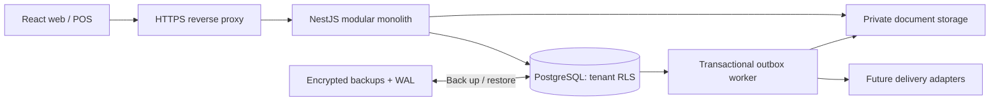

# Technical architecture

Status: design only. Confirmed stack: React + Vite + TypeScript + Tailwind; NestJS REST modular monolith; PostgreSQL. Target Windows development; Oracle Cloud later. No application or infrastructure has been deployed.

## Structure and boundaries
Use a TypeScript monorepo with npm workspaces and a committed lockfile. Propose Node 24 LTS and PostgreSQL 17, pin supported patch versions at implementation after ecosystem verification. Use NestJS with the Fastify adapter, PostgreSQL via node-postgres and Kysely for explicit SQL/locking, SQL migration files driven by a migration runner. Prefer explicit SQL over hiding RLS and transaction behaviour behind an ORM. OpenAPI generates frontend API types; the browser never imports persistence models or authoritative finance logic.

```text
stich-bill/
  apps/web/                  React feature routes, accessible POS, print views
  apps/api/src/modules/      NestJS bounded modules and REST controllers
  apps/worker/               Same codebase, outbox/render/notification worker entrypoint
  packages/api-client/       Generated OpenAPI client
  packages/domain/           Server-only money, tax, quantity and document policies
  packages/config/           Shared lint/TS config; no secrets
  database/migrations/       Reviewed forward SQL and verification notes
  database/seeds/            Synthetic development data only
  tests/{integration,e2e,load}/
  infra/{local,oracle}/       Proposed Compose/reverse-proxy/backup definitions
  docs/                      Task 001 documents
```
Only docs exist in Task 001. Marketing stays in its current separate repository. Proposed deployment hosts: www.stichbill.com for marketing and app.stichbill.com for app; /api on app host avoids cross-origin auth complexity. Domain ownership and DNS changes are later tasks.

## Modules
| Module | Owns | Public contracts |
|---|---|---|
| Identity | Passwords/sessions, verification/reset, device sessions | Login, logout, session refresh, password reset |
| Organisation | Tenants, shops, branches, memberships, roles | Active tenant context and permission evaluation |
| Catalogue | Product/variant, barcode, price versions, category/brand | Variant search and effective price lookup |
| Inventory | Stock balances/movements, stocktake, valuation, transfers | Lock/validate/post movement inside caller transaction |
| Tax | Registrations, rule versions, tax snapshots, compliance status | Pure deterministic calculation plus policy resolution |
| Sales | Drafts, invoices, adjustments, returns/exchanges, series | Finalise/reverse documents; immutable receipt snapshots |
| Money | Payment allocations, advances, refunds, financial journals, shifts | Balanced postings and settlement state |
| Customers | Profiles, contact, history, private measurements later | Permission-scoped customer lookup |
| Purchasing | Suppliers, orders, receipts, purchase invoices/returns | Receipt/valuation and payable posting |
| Operations | Expenses and employees; payroll later | Audited expense posting |
| Reporting | Read models and reconciled aggregations | As-of/period reports, safe exports |
| Engagement | Consent, loyalty, campaigns, channel adapters | Consent checked delivery requests |
| Platform | Subscriptions/entitlements and audited support access | Limits without relaxing financial/tenant permissions |
| Infrastructure | Outbox, files, audit, idempotency, health | Reliable side-effect dispatch |

Controllers validate DTOs and permissions, application services own transactions, domain functions calculate, repositories issue SQL. Modules call documented service interfaces; no arbitrary writes to another module's tables. A financial transaction can invoke Inventory/Money/Tax within one shared database transaction. Keep this in a single database until measured need justifies splitting services.



## REST contract
Version `/api/v1`. Use an explicit tenant route/header selected by the user, then validate membership server-side on every request. Never trust a caller's tenant_id embedded in payload; strip/deny it. Branch/shop also validated. UUID resource identifiers; opaque pagination cursors; bounded page sizes. UTC ISO timestamps and money as decimal strings/paise strings, never JS floating-point authority. Errors carry stable code, safe message, field errors and correlation ID, not SQL or other-tenant existence.

Representative commands: `POST /auth/sessions`, `GET /tenants/{tenant}/variants?query=`, `POST /tenants/{tenant}/sales/drafts`, `PATCH .../drafts/{id}` with version/If-Match, `POST .../drafts/{id}/finalise`, `POST .../returns`, `POST .../payments`, `POST .../shifts/{id}/close`, `GET .../invoices/{id}/document`, `POST .../invoices/{id}/share-links`. GET never changes finance. 401 unauthenticated, 403 insufficient action permission, 404 inaccessible resource, 409 stale version/idempotency mismatch/stock conflict, 422 invalid totals or tax setup. No raw API to update posted totals.

Idempotency required for finalisation, collections/refunds, goods receipts, adjustments and provider events. Bind key to tenant, operation and request hash; same hash returns stored result, changed payload returns 409. Unique business posting constraints survive key expiry. GET by client_transaction_id resolves uncertain network outcomes; UI never invents a second sale after timeout.

## Identity and runtime
First-party credential authentication; Argon2id password hashes, server-side revocable sessions, HttpOnly/Secure/SameSite cookies and CSRF controls. Proposed store is PostgreSQL, avoiding Redis initially. Global identity account may join multiple tenants; tenant memberships and business profiles remain scoped. Support access is explicit/time-bound/audited; no universal owner password. Email verification/reset needs a later owner-selected delivery route; use a local mail catcher in development. No paid service is connected now.

Start with web, API, worker, PostgreSQL and local file storage behind a reverse proxy. Worker polls outbox using row locks/leases. No Kafka or Redis required. Use a DocumentStore interface for private local-volume storage initially, S3-compatible storage later if needed; all downloads pass tenant checks or scoped expiring share tokens. Render PDF/PNG in isolated headless-browser workers with outbound network denied and trusted templates/fonts. Store immutable rendered snapshots/checksums and template version; renderer retries never post sales again.

## Windows local development plan
Windows 11, Git, supported Node LTS, npm, Docker Desktop with WSL2 (subject to its licensing) or native PostgreSQL as an alternative. Check port conflicts and avoid Unix-only npm scripts. Scripts use Node cross-platform orchestration; PowerShell examples go in Task 002 README. Local Compose binds DB/mail to loopback; dedicated local credentials in ignored files, `.env.example` names only. Separate test DB; no production connection string in test commands. Each cloud task already has an isolated workspace: use existing checkouts, no worktree unless explicitly requested.

Task 002 will create these commands: `npm ci`, `npm run dev`, `npm run test:integration`, `npm run build`. They are proposed, not currently executable. Environment initialization is an explicit script with prerequisite detection, no silent database reset.

## Oracle deployment plan
Choose VM architecture after testing native dependencies/headless browser images on AMD64/ARM64. Free Tier capacity/limits are not guaranteed; approve RPO/RTO and budget before production. Initial single-VM topology is a cost-conscious pilot with a single point of failure, not HA. PostgreSQL has no public port. Use HTTPS, OS patching, restricted SSH, process/container health checks, log rotation and monitored disk space. Backups must live outside the VM failure domain. No mandatory paid observability: structured logs, metrics and open-source exporters suffice. Production deployment is Phase 11 and separately approved.

## Finance, dates and offline seam
The database transaction is the source of truth. Posted accounting/stock facts are append-only with reversals. Reports use only posted facts and mark freshness; no charts populated with demo values in production. India financial-year numbering uses configured legal local calendar and financial-year key; historical dates/rules remain fixed.

Future offline: client-generated UUID transaction ID, registered device, device-local sequence, base-version and price/rule version references are reserved from Phase 1. Phase 10 introduces IndexedDB queues and an explicit sync API using the same posting service. Server validates stock, prices, registration and tax; conflicts enter review rather than silently rewriting receipts. An offline provisional receipt is not automatically a legal issued invoice. Legal numbering/device series and fiscal-period handling need CA/product approval before enabling offline issuance. No queues, service workers or offline sale implementation in Task 001.
